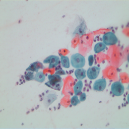
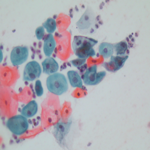
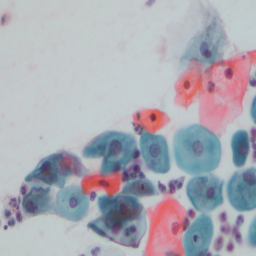
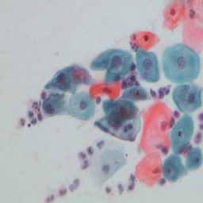
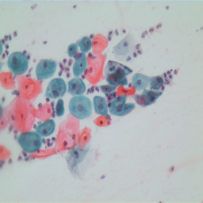

# MediAug

[](https://www.python.org/downloads/)
[](https://opensource.org/licenses/MIT)

Data augmentation toolkit for histology slide images, primarily developed for cervical cancer detection via Pap smear analysis. Supports general image augmentation techniques as well as specialized operations like cell insertion and blending.



## Results

MediAug supports several augmentation techniques. Here are examples of each:

| Technique | Output |
|-----------|--------|
| Rotation |  |
| Elastic Deformation |  |
| Random Crop |  |
| Zoom |  |
| Flip |  |

## Installation

```bash
git clone https://github.com/smwade/MediAug
cd MediAug
python setup.py install
```

## Datasets

MediAug supports two open Pap smear datasets:

### SMEAR

917 individual cells segmented by nucleus and cytoplasm.
[Download](https://mde-lab.aegean.gr/downloads)

### SIPaKMeD

4,049 images of isolated cells manually cropped from 966 cluster cell images. Cells are divided into five categories: normal, abnormal, and benign.
[Download](http://cs.uoi.gr/~marina/sipakmed.html)

## Custom Dataset

The data pipeline works with custom datasets. Convert your data to this format:

```
slides/
  metaplastic/
    image/
    mask/
  parabasal/
    image/
    mask/
  ...

cells/
  metaplastic/
    image/
    mask/
  parabasal/
    image/
    mask/
  ...
```

## Notebooks

Interactive notebooks demonstrating key features (datasets, operations, pipelines) are in `notebooks/`.

## CLI

MediAug includes a CLI for common tasks:

```bash
# See all available commands
mediaug --help

# Generate an augmented dataset
mediaug generate-augment-dataset \
  --slide_dir <slide_dir> \
  --cell_dir <cell_dir> \
  --out_dir <out_dir> \
  --num 1000 \
  --max_cells 10

# Prepare images for Pix2Pix training
mediaug prepare-pix2pix-images \
  --image_dir <image_dir> \
  --mask_dir <mask_dir> \
  --out_dir <out_dir> \
  --split_ratio <split_ratio>

# Recursively resize all images in a directory
mediaug resize-images \
  --input_dir <input_dir> \
  --out_dir <out_dir> \
  --w 256 \
  --height 256
```
